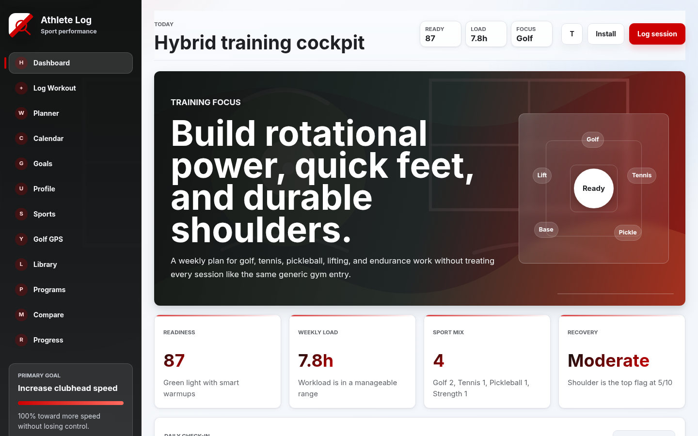
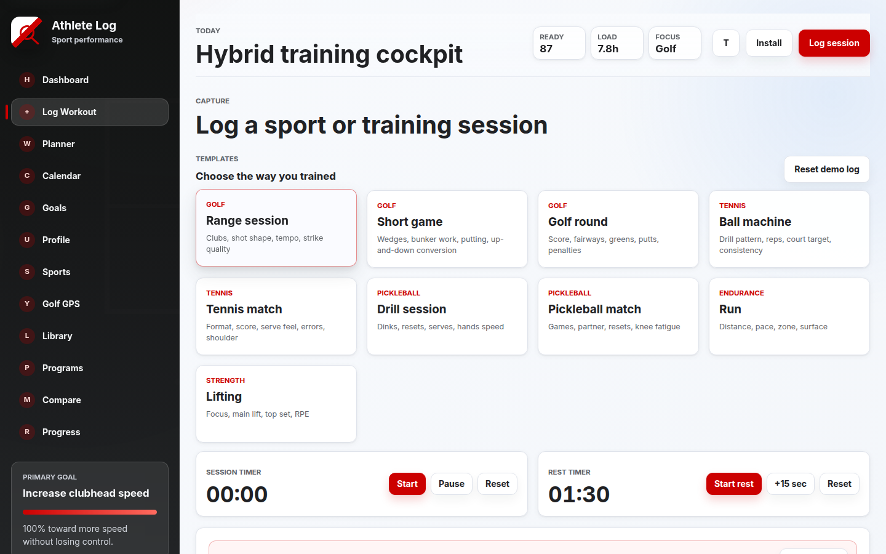
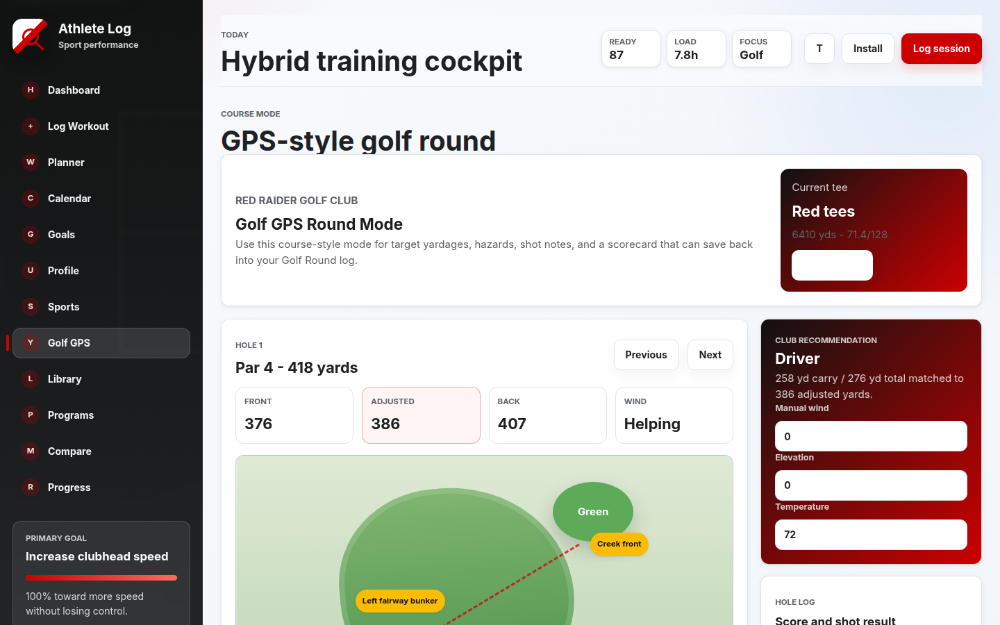
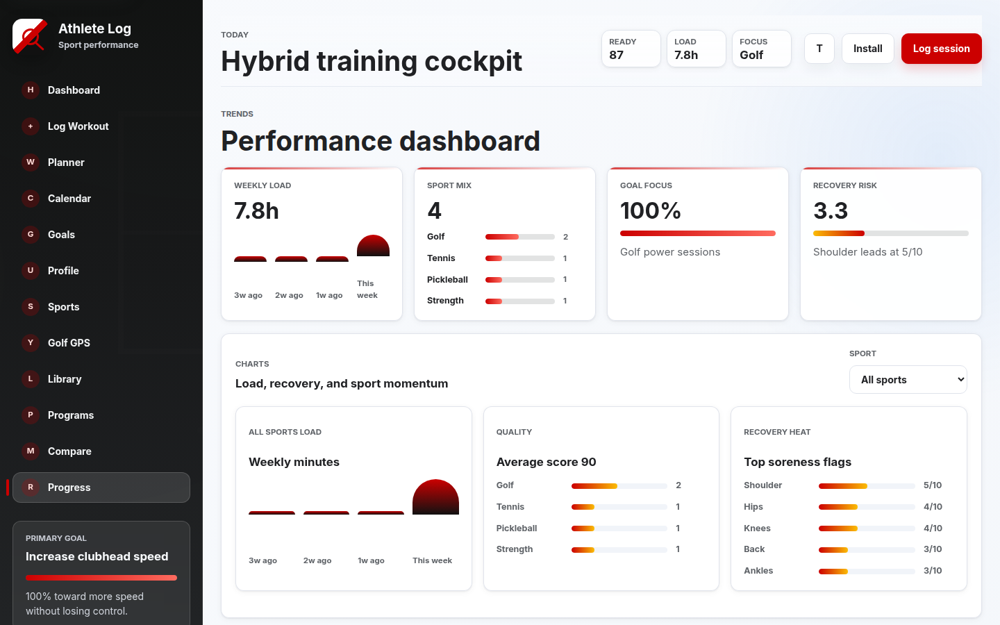
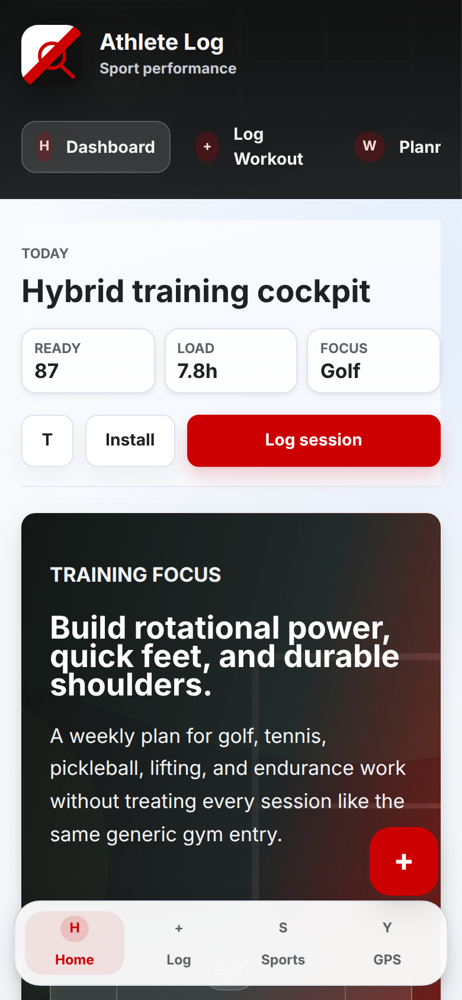

# Athlete Log

[](https://github.com/thejayer/athlete-log/actions/workflows/ci.yml)
[](LICENSE)

A static sport-performance training log. Hevy-style session capture, organized around golf, tennis, pickleball, endurance, and lifting, with a GPS-style golf round mode.

**[Live demo](https://thejayer.github.io/athlete-log/)** · no build step · data stays in the browser

Screenshots below use the built-in synthetic **Athlete** demo log. There are no real names in the sample data.



## Try it

- **Live demo:** [thejayer.github.io/athlete-log](https://thejayer.github.io/athlete-log/)
- **Local:** open `index.html` in a browser, or serve the folder (`python3 -m http.server`) so the installable PWA / service worker can register.

GitHub Pages deploys from `main` only. A pull request does not refresh the live demo until it is merged.

The reset control restores the synthetic training log. Sessions persist in `localStorage` and mirror to IndexedDB when the browser allows it.

## Features

- Template-driven logging for golf range, short game, and rounds; tennis and pickleball drills or matches; running; and Hevy-style lifting sets
- Dashboard readiness, weekly load, sport mix, recommendations, and a Today command center
- Weekly planner, calendar, goals, and program builder (including a smart week from profile and recovery)
- Progress analytics: personal records, load trends, sport mix, recovery heat, and session compare
- Golf GPS round mode on a simulated course, with yardages, club recommendations, scorecard, and save-to-log
- Drill library, custom templates, profile setup, and JSON/CSV export-import
- Light/dark theme, mobile bottom nav, and a service worker so the app is installable on localhost or HTTPS

## Screenshots

Demo data only — profile name **Athlete**, fictional Red Raider Golf Club.

**Log a session**



**Golf GPS round**



**Progress**



**Mobile**



## Development

Pull requests into `main` run syntax checks, ESLint, Prettier, `tsc --checkJs`, Vitest, and a static-app integrity verifier. Merging to `main` runs the same checks and deploys only the browser app (`index.html`, JS/CSS, assets, manifest) to GitHub Pages.

```bash
npm ci
npm run check:js       # node --check on app and script files
npm run lint           # eslint
npm run typecheck      # tsc --noEmit against JSDoc @typedefs in types.js
npm run format:check   # prettier --check
npm test               # vitest run
npm run test:verify    # static app file/manifest/service-worker checks
npm run build:pages    # copy the browser app into dist/ for Pages
```

Unit tests live in `tests/` with a small `tests/helpers/loadAppContext.mjs` helper that loads the script-tag files in a Node `vm` sandbox:

- `tests/utils.test.mjs` — date helpers, safe storage, CSV parsing
- `tests/analytics.test.mjs` — readiness, load buckets, personal records, recommendations
- `tests/prepare-pages.test.mjs` — Pages artifact contains the static app only

Tests for `app.js`, `render.js`, and `events.js` are deferred; those files are tightly coupled to the DOM. Mutable state lives in `store.js`.

## License

[GNU General Public License v3.0](LICENSE) (`GPL-3.0-only`).
